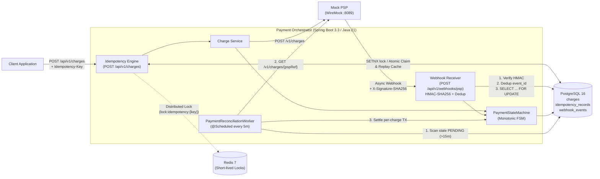

# Payment Orchestrator

A fault-tolerant payment orchestration backend built with **Java 21** and **Spring Boot 3.3+**. Designed around the realities of distributed payment processing: client network drops, duplicate or out-of-order PSP webhooks, concurrent delivery races, and lost callback recovery.

---

## System Architecture



---

## Key Engineering Problems Solved

### 1. Network Drop Resilience & Guaranteed Single-Charge Idempotency
Mobile and browser clients frequently experience connection drops after sending `POST /api/v1/charges` but before receiving the HTTP response. Blindly retrying without idempotency double-charges the customer.
- **Atomic Claim**: Incoming requests must supply an `Idempotency-Key` header. `IdempotencyManagerService` atomically claims the key (`INSERT ... ON CONFLICT DO NOTHING`) in status `IN_PROGRESS` with a Canonical-JSON SHA-256 fingerprint (`RequestHasher`) of the request payload.
- **Concurrent In-Flight Protection**: If a second identical request arrives while the first is still awaiting the PSP, the server immediately returns `409 Conflict` (`Request currently being processed. Please retry shortly.`).
- **Payload Tamper Detection**: Reusing an `Idempotency-Key` with a modified payload (e.g., changing `49900` öre to `99900` öre) fails closed with `422 Unprocessable Entity`.
- **Zero-Allocation Replay**: Once finalized (`COMPLETED`), subsequent retries within the 24-hour TTL return the exact cached HTTP status and JSON body with `Idempotent-Replayed: true`—without touching the PSP or creating a second charge.
- **Short Transactions Around Network I/O**: Database transactions are never held open across outbound PSP HTTP calls. Each persistence step commits via isolated `TransactionTemplate` scopes so slow PSP responses cannot exhaust the HikariCP connection pool.

### 2. Monotonic State Progression & Out-of-Order Webhook Defense
Payment Service Providers (PSPs) deliver webhooks at-least-once and without strict ordering guarantees (`charge.captured` can arrive before `charge.authorized`, or `charge.authorized` can be re-delivered after a payment is already captured).
- **Cryptographic Authentication**: `WebhookSignatureVerifier` validates the `X-Signature-SHA256` header against the raw request byte array using constant-time `MessageDigest.isEqual` HMAC-SHA256 comparison before JSON deserialization. Forged or tampered payloads are rejected with `401 Unauthorized`.
- **Event Deduplication**: `webhook_events` stores every processed `event_id`. Duplicate deliveries are short-circuited via `INSERT ... ON CONFLICT (event_id) DO NOTHING` and acknowledged with `200 OK` (`DUPLICATE`).
- **Monotonic FSM (`PaymentStateMachine`)**: Late events attempting to move a charge into a state it has already passed (e.g., `CAPTURED` receiving `charge.authorized`) are treated as idempotent no-ops (`200 OK`), while invalid backward or terminal-state transitions throw `IllegalStateTransitionException`.
- **Out-of-Order Catch-Up**: If `charge.captured` arrives while a charge is still `PENDING` (because `charge.authorized` was delayed or dropped), `WebhookService` applies the implied `CHARGE_AUTHORIZED` transition first before `CHARGE_CAPTURED` inside the same row-locked transaction.

### 3. Zero Floating-Point Rounding (Minor Unit Storage)
IEEE 754 floating-point types (`float`/`double`) cannot accurately represent base-10 fractions (`0.1 + 0.2 != 0.3`). All monetary values in this system are stored and transmitted as 64-bit integers (`BIGINT` / `long`) in the currency's smallest minor unit (**öre** for `SEK`, e.g., `49900` = `499.00 SEK`), eliminating rounding drift across the API, database, and PSP boundary.

### 4. Automated Reconciliation for Dropped Webhooks
Webhooks can fail to arrive due to transient ingress outages, DNS issues, or PSP delivery exhaustion.
- `PaymentReconciliationWorker` runs every 5 minutes (`@Scheduled`) and queries `charges` stuck in `PENDING` for more than 15 minutes using the composite index `idx_charges_status_created_at (status, created_at)`.
- **Pre-Dispatch Orphans**: Charges lacking a `psp_reference` are marked `FAILED` with reason `EXPIRED_BEFORE_GATEWAY_DISPATCH`.
- **Active Polling**: Charges with a `psp_reference` query `GET /v1/charges/{pspReference}` outside of any database transaction, then re-lock the charge row (`SELECT ... FOR UPDATE`) in an isolated `PROPAGATION_REQUIRES_NEW` transaction so a single failing PSP lookup never aborts the rest of the reconciliation batch.

---

## State Transition Matrix

`PaymentStateMachine` enforces strict monotonic progression across `ChargeStatus`:

| Current State \ Incoming Event | `CHARGE_AUTHORIZED` (`charge.authorized`) | `CHARGE_CAPTURED` (`charge.captured`) | `CHARGE_FAILED` (`charge.failed`) | `CHARGE_REFUNDED` (`charge.refunded`) |
| :--- | :--- | :--- | :--- | :--- |
| **`PENDING`** | **-> `AUTHORIZED`** | **-> `CAPTURED`** *(via implied `AUTHORIZED` catch-up)* | **-> `FAILED`** | Invalid (`IllegalStateTransitionException`) |
| **`AUTHORIZED`** | No-Op *(Idempotent)* | **-> `CAPTURED`** | **-> `FAILED`** | Invalid (`IllegalStateTransitionException`) |
| **`CAPTURED`** | No-Op *(Already passed)* | No-Op *(Idempotent)* | Invalid (`IllegalStateTransitionException`) | **-> `REFUNDED`** |
| **`FAILED`** *(Terminal)* | Invalid (`IllegalStateTransitionException`) | Invalid (`IllegalStateTransitionException`) | No-Op *(Idempotent)* | Invalid (`IllegalStateTransitionException`) |
| **`REFUNDED`** *(Terminal)* | Invalid (`IllegalStateTransitionException`) | Invalid (`IllegalStateTransitionException`) | Invalid (`IllegalStateTransitionException`) | No-Op *(Idempotent)* |

---

## Running Locally

### Prerequisites
- **Java 21+**
- **Docker & Docker Compose** (optional for tests; Testcontainers automatically falls back to an embedded PostgreSQL binary if Docker is not running)

### 1. Start Infrastructure (PostgreSQL, Redis, WireMock PSP)
```bash
docker compose up -d
```
This starts:
- **PostgreSQL 16** on `localhost:5432` (`payments_db`)
- **Redis 7** on `localhost:6379`
- **WireMock Mock PSP** on `localhost:8089` (pre-loaded with stubs in `./wiremock/mappings`)

### 2. Run the Application
```bash
./mvnw spring-boot:run
```

### 3. Example API Calls

**Create a Charge (499.00 SEK):**
```bash
curl -i -X POST http://localhost:8080/api/v1/charges \
  -H "Content-Type: application/json" \
  -H "Idempotency-Key: order-98123-attempt-1" \
  -d '{
    "accountId": "acc_customer_42",
    "amountMinor": 49900,
    "currency": "SEK"
  }'
```

**Send a Signed PSP Webhook:**
```bash
BODY='{"eventId":"evt_01","eventType":"charge.captured","pspReference":"psp_12345","amountMinor":49900}'
SIG=$(printf "%s" "$BODY" | openssl dgst -sha256 -hmac "test_hmac_secret_key_123" | awk '{print $2}')

curl -i -X POST http://localhost:8080/api/v1/webhooks/psp \
  -H "Content-Type: application/json" \
  -H "X-Signature-SHA256: $SIG" \
  -d "$BODY"
```

**Fetch a Charge by ID:**
```bash
curl -i http://localhost:8080/api/v1/charges/<charge-uuid>
```

### 4. Run the Verification & Integration Test Suite
```bash
./mvnw verify
```
Runs 80 unit and integration tests covering:
- Full `PaymentStateMachine` transition matrix
- Canonical SHA-256 request hashing
- Exact idempotency replay under network drop
- `422 Unprocessable Entity` on altered payload reuse
- 20-thread parallel webhook delivery race (`CountDownLatch` + `ExecutorService`)
- Stale `PENDING` charge reconciliation against WireMock

---

## Trade-offs & Scalability

### 1. Optimistic vs. Pessimistic Locking Under Heavy Webhook Traffic
`Charge` carries both `@Version Integer version` (optimistic locking) and `ChargeRepository.findByPspReferenceForUpdate` (`@Lock(LockModeType.PESSIMISTIC_WRITE)` / `SELECT ... FOR UPDATE`).
- **Why Pessimistic Locking for Webhooks**: PSPs frequently emit bursts of related webhooks (`charge.authorized` followed milliseconds later by `charge.captured`, or concurrent duplicate retries) targeting the same `psp_reference`. Under optimistic locking, the losing transaction throws `OptimisticLockingFailureException`, rolling back the transaction and returning a `5xx`/`409` to the PSP—triggering exponential retry storms. `SELECT ... FOR UPDATE` serializes concurrent mutations for the *same* charge at the row level in PostgreSQL for a few milliseconds so both webhooks succeed cleanly in sequence, while `@Version` remains as a safety net for non-locking code paths.
- **Contention Scope**: Row-level locks only block concurrent updates to the *exact same* `charge.id` / `psp_reference`; webhooks for different customers execute in parallel with zero lock contention.

### 2. Why Redis Distributed Locks Complement Database Constraints
PostgreSQL's unique primary key on `idempotency_records(idempotency_key)` is the ultimate source of truth for correctness—even if Redis is completely unavailable, two charges can never be created for the same key. However, pairing Redis (`SETNX lock:idempotency:{key} EX 10`) with PostgreSQL provides two operational advantages under high load:
- **Offloading Hot Retry Storms**: Aggressive client retry loops or mobile SDK bugs hammering the same `Idempotency-Key` are rejected at the sub-millisecond in-memory edge (`409 Conflict`) without acquiring a JDBC connection or generating dead tuples in PostgreSQL's MVCC heap.
- **Fast Replay Caching**: Completed idempotency responses can be served directly from Redis, reserving PostgreSQL IOPS for write-path state transitions.

### 3. Scaling to 10,000 Transactions Per Second (TPS)
At 10,000 TPS (~860M charges/day), a single-node relational database and synchronous webhook processing become bottlenecks. Evolving this architecture for 10k TPS requires:
1. **Asynchronous Webhook Ingestion via Kafka**: Decouple webhook signature verification from database persistence. The HTTP endpoint verifies the HMAC signature and publishes the raw event to a **Kafka** topic partitioned by `psp_reference` (guaranteeing per-charge ordering and eliminating `SELECT ... FOR UPDATE` database lock contention), returning `202 Accepted` in <2ms.
2. **Time- & Hash-Partitioned Tables**: Partition `charges`, `idempotency_records`, and `webhook_events` (e.g., weekly range partitions on `created_at` or hash partitions on `account_id` / `idempotency_key`). Dropping expired idempotency partitions (`DROP TABLE`) replaces expensive `DELETE` queries and vacuum overhead.
3. **Skip-Locked Partitioned Reconciliation**: Replace the single `@Scheduled` query with a partitioned consumer or `SELECT ... FOR UPDATE SKIP LOCKED LIMIT 500` so a fleet of orchestrator nodes can horizontally share reconciliation batches without polling the same charges.
4. **Connection Pool & Virtual Threads**: Enable Java 21 Virtual Threads (`spring.threads.virtual.enabled=true`) so outbound PSP HTTP calls do not pin OS carrier threads, paired with **PgBouncer** in transaction-pooling mode in front of PostgreSQL shards.